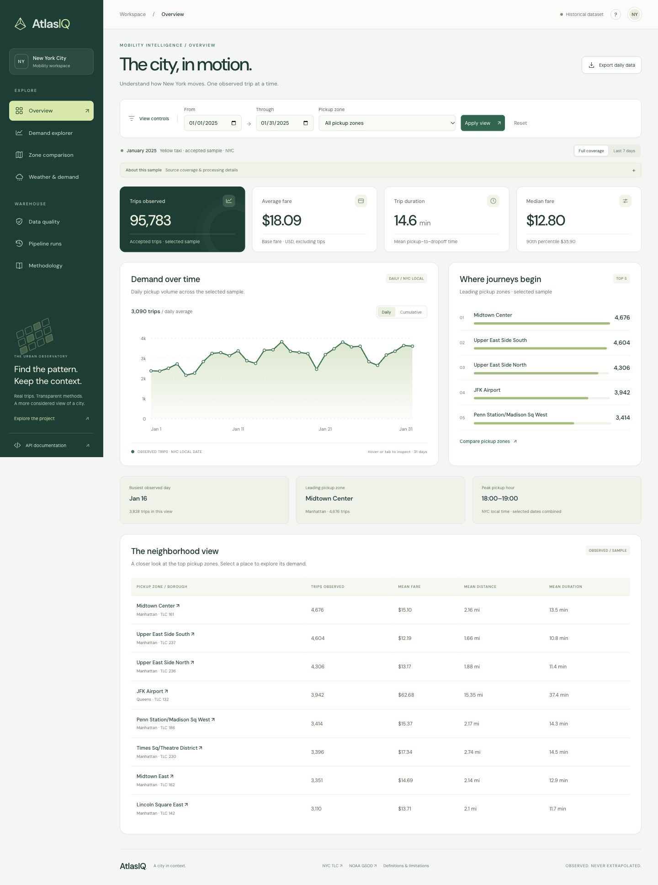

# AtlasIQ

A pipeline and dashboard for exploring NYC Yellow taxi trips. It takes monthly source files through validation, PostgreSQL, and dbt before serving the results through FastAPI and a TypeScript dashboard.

I focused on making each chart traceable to its source: checksums, rejected rows, load history, and publication checks are part of the application.

**Python · PostgreSQL · dbt · FastAPI · Airflow · TypeScript · Docker**



[Case study](portfolio/case-study.md) · [Architecture](docs/ARCHITECTURE.md) · [Verification](docs/VERIFICATION.md)

## Run the demo

Install Docker with Compose.

```sh
git clone https://github.com/anushaxrama/atlasiq.git
cd atlasiq
docker compose up -d postgres
docker compose build api
docker compose run --rm api atlasiq demo --month 2025-01 --limit 100000
docker compose up -d api
```

Open the [dashboard on port 8020](http://127.0.0.1:8020) or [API docs](http://127.0.0.1:8020/docs). The first run downloads the full January file, about 59 MB, plus reference data before selecting 100,000 records. It needs network access.

PostgreSQL uses local port 5544. A fresh clone has no populated database.

## What to explore

- Demand by date, hour, and zone, plus fare and trip-efficiency comparisons.
- Rejected records and source/run history alongside accepted trips.
- Date and zone filters, keyboard chart inspection, and CSV exports.
- Monthly partition replay without duplicating trip identities.

New loads stay out of the analytical API until dbt transformations and quality checks finish.

## Code to start with

- `src/atlasiq/` — ingestion, CLI, API, and compiled interface.
- `frontend/` — TypeScript dashboard source.
- `warehouse/` — dbt models and tests.
- `orchestration/` — Airflow workflow.
- `analyses/` — twelve SQL analyses.

See the [runbook](docs/RUNBOOK.md) for native development and [backfill guide](docs/MULTI_MONTH_BACKFILL.md) for multi-month loads.

## Recorded results and scope

The checked-in [three-month record](docs/evidence/multi-month-backfill.json) covers 300,000 selected records: 284,899 accepted trips and 15,101 rejections. Replaying February preserved its counts and trip-ID fingerprints. Both combined builds passed 17 dbt tests.

The [verification notes](docs/VERIFICATION.md) also record 28 Python tests, a five-task Airflow run, and 12 browser checks. These are captured local runs, not hosted-service measurements.

Equal monthly sample caps do not estimate city-wide demand growth. Weather comparisons are descriptive. Full-month throughput, hosting, authentication, and backup restoration remain unverified. See the [deployment guide](docs/DEPLOYMENT.md).

Data: [NYC TLC](https://www.nyc.gov/site/tlc/about/tlc-trip-record-data.page) and [NOAA GSOD](https://www.ncei.noaa.gov/products/land-based-station/global-summary-of-the-day). Preserve the attribution in [sources](docs/SOURCES.md).
