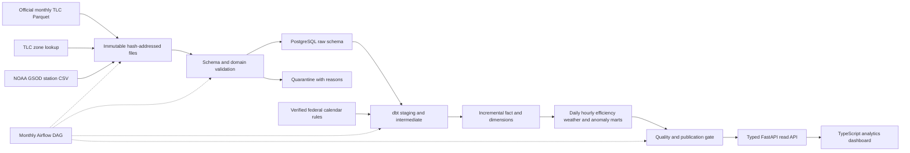

# Architecture and lineage

The dashboard consumes the actual API. Raw extraction is independent of dbt business transformations. DuckDB efficiently scans/samples official Parquet files; it is not the warehouse. A partition advisory lock and one PostgreSQL transaction atomically replace raw trip rows and their active manifest. A failure rolls back the replacement, retaining the prior partition. File metadata and run failures remain inspectable.

The API publication barrier refuses analytical reads while active partitions have not passed transformation/quality/publication. Operations/run-history endpoints stay available. dbt builds are transactional per model, not globally atomic; the gate avoids advertising partially refreshed analytical results. For a larger production system, build versioned schemas and swap serving views atomically to avoid an availability pause during refresh.

The fact model detects changed partition run IDs. Its pre-hook deletes each changed monthly fact partition in the same model transaction; the incremental selection reloads it completely. This intentionally supports deletions and corrected source rows. Unchanged partitions are retained. There is no unsupported claim of row-level CDC or exactly-once distributed ingestion.

Generated dbt lineage/docs: `uv run dbt docs generate --project-dir warehouse --profiles-dir warehouse`, then `uv run dbt docs serve --project-dir warehouse --profiles-dir warehouse --port 8083`. Native local profile defaults use port 5544. CLI transformations derive profile environment values from ATLAS_DATABASE_URL.
