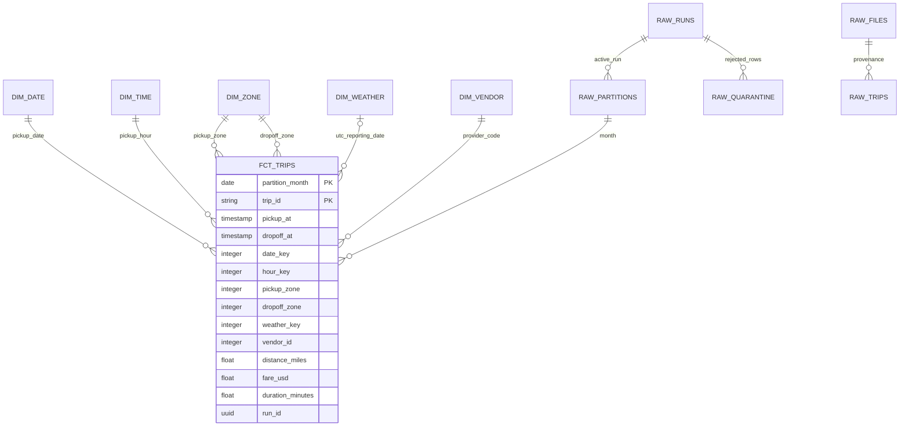

# Logical star schema

Raw primary/foreign keys are enforced in PostgreSQL. dbt analytical relationships are tested rather than advertised as declared physical FKs. `dim_zone` is the current official lookup (Type 1 overwrite); no invented historical SCD effective dates. `dim_weather` is unique by station reporting date. A nullable weather key retains trips with unknown weather and prevents implicit row loss. Unknown/outside-NYC official zone codes remain labeled.
