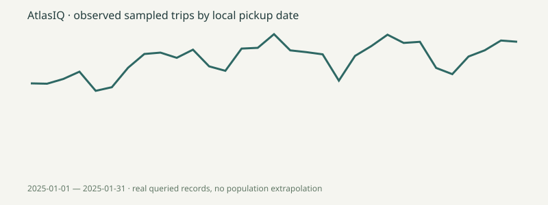

# Insights from the executed warehouse

Generated from actual SQL queries. See [full results](evidence/analyses.json), [verification](evidence/verification.json) and [measured query plan](evidence/query-plan.json).

- The warehouse contains **95,783 accepted sampled trips**. Rejected rows are retained in quarantine. This is not the full TLC month or all NYC mobility.
- The highest-count pickup zone in this sample is **Midtown Center (Manhattan)**, with **4,676 observed trips**, according to analysis 01. This ranking is conditional on deterministic sampling and exclusions.
- Weather-day group comparisons from analysis 06 are listed below. They are descriptive, include partial UTC days at local filter edges and do not isolate a causal weather effect.

| Condition | Reporting days | Mean observed trips per day |
|---|---:|---:|
| Wet | 6 | 2567.00 |
| Dry | 26 | 3091.58 |

No business optimization, savings, performance improvement or causal effect is claimed. Query timings include connection overhead on the recorded local environment; they are not cloud production latency. One month cannot support seasonality claims.
